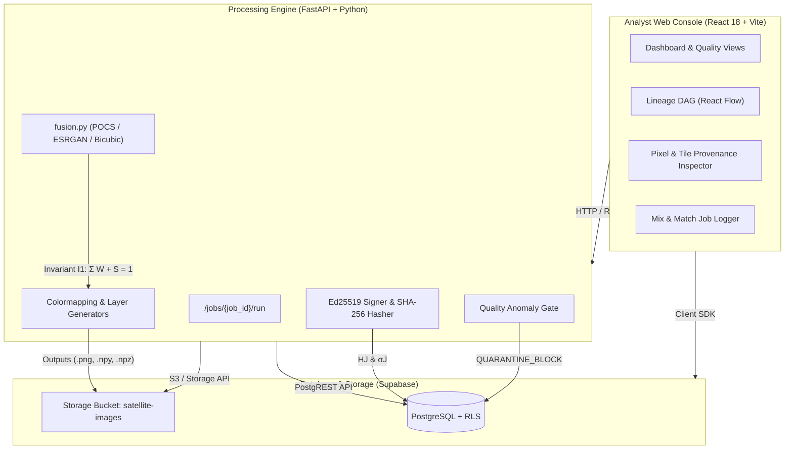

# OrbitalTrace 🛰️

> **Enterprise Satellite Multi-Frame Super-Resolution & Per-Pixel Provenance Engine**  
> *Compliant with Invention Disclosure Document (IDF §6.3–§6.5) Provenance & Cryptographic Invariant Specifications.*

[](https://www.typescriptlang.org/)
[](https://react.dev/)
[](https://fastapi.tiangolo.com/)
[](https://supabase.com/)
[](LICENSE)

---

## 📌 Executive Summary

Modern satellite observation pipelines frequently synthesize high-resolution imagery from low-resolution, occluded sensor telemetry using multi-frame algorithms (e.g., POCS, iterative projection, ESRGAN). However, traditional pipelines produce fused images as monolithic outputs—obscuring which specific pixels originate from real physical sensors and which are synthetic hallucinations or interpolations.

**OrbitalTrace** solves this transparency challenge. It provides an end-to-end multi-frame fusion and provenance tracking system that computes, propagates, and cryptographically signs **5 per-pixel provenance tensor layers** alongside each reconstructed product. Every reconstructed pixel carries strict mathematical accounting of physical vs. synthetic origins, backed by an immutable SHA-256 hash-linked DAG and Ed25519 digital signatures.

---

## 🌟 Key Capabilities

### 1. Mathematical Provenance Invariant I1
* **Strict Conservation:** For every spatial pixel $(u, v)$, the sum of ancestral sensor frame contributions $\sum_f W_I(u, v)[f]$ and synthetic share $S_I(u, v)$ is conserved:
  $$\sum_{f \in \mathcal{F}} W_I(u, v)[f] + S_I(u, v) = 1.0 \quad (\text{Max Deviation } < 10^{-6})$$
* **No Artificial Binary Collapse:** Eliminates clear-frame weight renormalization flaws, preserving smooth continuous float32 blending across partial cloud boundaries.

### 2. 5 Real-Time Provenance Layers
* **`IMAGE`:** Fused multi-frame composite. Heavily occluded holes are filled using a normalized Gaussian convolution ($\sigma = 8\text{ px}$) that completely eliminates radial spoke or Voronoi artifacts.
* **`CLASS_MAP`:** Continuous 3-state classification:
  * **Class 0 (Observed / Green):** Sensor-dominant ($S \le 0.20 \land \max_f W \ge 0.30$).
  * **Class 1 (Weakly Observed / Amber):** Partially occluded or multi-sensor blended ($0.20 < S < 0.80$).
  * **Class 2 (Synthesized / Red):** Generative or heavily interpolated ($S \ge 0.80$).
* **`UNCERTAINTY`:** Per-pixel uncertainty combining spatial synthetic contamination with normalized inter-frame photometric variance ($U = \min(1, S + (1-S) \cdot v)$), rendered in a continuous `inferno` colormap.
* **`SOURCE_INDEX`:** Dominant physical sensor attribution mapping each pixel to its contributing frame ID (or `-1` / Grey for synthetic fill).
* **`SYNTHETIC_SHARE`:** Continuous float32 generative/interpolation contamination share $S(u, v) \in [0, 1]$.
* **`ERROR_MAP`:** Absolute radiometric difference against ground truth ($\Delta = |I - \text{GT}|$). Ground truth is strictly isolated for quality assessment (PSNR, SSIM) and never feeds fusion.

### 3. Hash-Linked DAG & Cryptographic Audit
* **SHA-256 DAG Topology ($H_J$):** Every job cryptographically links its input hashes, parent hashes, algorithm contamination ratio ($r_a$), and output layer hashes.
* **Ed25519 Signatures ($\sigma_J$):** All reconstruction artifacts are signed with a 256-bit asymmetric private key, generating verifiable tamper audit trails.
* **Quality-Regression Anomaly Gating:** Automated pipeline gates detect adversarial super-resolution artifacts ($\Delta\text{SSIM} > \tau_{\text{SSIM}} \land \Delta\text{PSNR} < -\tau_{\text{PSNR}}$), quarantining suspicious outputs (`QUARANTINE_BLOCK`).

### 4. Interactive Analyst Console (React + Vite)
* **Interactive Lineage Tree:** Real-time DAG visualization rendered with `@xyflow/react` showing raw telemetry inputs, refinement branches, diamond merges, and quarantine nodes.
* **Dual-Mode Pixel Inspector:** 
  * *Pixel Mode:* Crosshair inspection displaying exact coordinates, decoded classification, uncertainty, synthetic share, dominant sensor frame, and radiometric error.
  * *Tile Mode:* $32 \times 32$ block telemetry showing observed %, weak %, synthesized %, and individual sensor contribution percentages.
* **Mix-and-Match Job Logger:** Allows analysts to blend raw sensor telemetry with previously reconstructed parent products.

---

## 🏗️ System Architecture



---

## 📁 Repository Structure

```text
OrbitalTrace/
├── README.md                     # Project overview and specifications
├── SETUP.md                      # Detailed step-by-step setup guide for new machines
├── .env.example                  # Frontend environment variables template
├── index.html                    # Single-page application entry point
├── package.json                  # Frontend dependencies and build scripts
├── vite.config.ts                # Vite configuration
├── tailwind.config.ts            # Tailwind CSS design system
│
├── src/                          # Frontend source code (React 18 + TypeScript)
│   ├── App.tsx                   # Main layout and Supabase auth listener
│   ├── main.tsx                  # Application router and entrypoint
│   ├── globals.css               # Global styling, glassy panels, animations
│   ├── components/               # UI components (Tooltip, Navigation, Badges)
│   ├── lib/supabase/             # Supabase client singleton
│   └── pages/                    # Core view pages
│       ├── DashboardPage.tsx     # High-level pipeline stats and metrics
│       ├── LineagePage.tsx       # Dynamic React Flow Diamond DAG
│       ├── PixelInspector.tsx    # Dual-mode pixel & tile provenance inspector
│       ├── LogNewJobPage.tsx     # Mix-and-match job submission form
│       ├── ManageFramesPage.tsx  # Telemetry frame library and upload
│       └── ValidationPage.tsx    # Patent disclosure telemetry readouts
│
├── backend/                      # Python FastAPI backend service
│   ├── .env.example              # Backend environment variables template
│   ├── main.py                   # FastAPI application & pipeline orchestration
│   ├── fusion.py                 # Core IDF §6 provenance propagation engine
│   ├── requirements.txt          # Python dependencies (NumPy, SciPy, FastAPI, etc.)
│   ├── keys/                     # Ed25519 cryptographic key storage
│   ├── data/                     # Audit logs and tamper verification logs
│   ├── tests/                    # End-to-end automated verification test suite
│   │   └── test_layers.py        # Validates Invariant I1, non-redundancy, continuous S
│   └── out/                      # Local diagnostic layer renders
│
├── sql/                          # Database schema DDL & migrations
│   ├── schema.sql                # Base PostgreSQL table definitions (11 tables)
│   ├── idf_migration.sql         # IDF §6 constraint expansion & record_hash
│   ├── fix_permissions_and_schema.sql # Grants, RLS, and column backfills
│   ├── enable_reconstructed_as_frames.sql # Enables multi-generation DAG inputs
│   └── review3_auth_rls.sql      # Supabase Auth policies and roles
│
├── scripts/                      # Automation & evaluation utilities
│   ├── seed_idf_screenshots.py   # Automated 3-generation diamond DAG pipeline runner
│   ├── reset_everything.py       # Safe storage and database purge utility
│   └── recalculate_ground_truth.py # Benchmark evaluator
│
└── frames/                       # Calibration test frames & smooth continuous cloud masks
    ├── frame_1.png .. frame_4.png # Progressive telemetry frames (5%, 20%, 40%, 60%)
    └── mask_1.png .. mask_4.png   # Continuous float32 cloud masks
```

---

## ⚡ Quick Start

For detailed step-by-step instructions on setting up Supabase, Python virtual environments, and database migrations, see **[SETUP.md](file:///Users/spunky/Desktop/dbs/OrbitalTrace/SETUP.md)**.

### 1. Prerequisites
* **Node.js:** v18.0.0 or higher
* **Python:** v3.10 or higher
* **Supabase Project:** Cloud instance or local Supabase CLI

### 2. Environment Setup
```bash
# Frontend configuration
cp .env.example .env.local
# Edit .env.local with your VITE_SUPABASE_URL and VITE_SUPABASE_ANON_KEY

# Backend configuration
cp backend/.env.example backend/.env
# Edit backend/.env with your SUPABASE_URL and SUPABASE_SERVICE_KEY
```

### 3. Install & Start Backend
```bash
cd backend
python3 -m venv venv
source venv/bin/activate
pip install -r requirements.txt

# Run automated mathematical verification tests
python tests/test_layers.py

# Start FastAPI server
fastapi dev main.py
# Running on http://localhost:8000
```

### 4. Install & Start Frontend
```bash
# In the root repository directory
npm install
npm run build   # Type-check and verify production bundle
npm run dev     # Starts Vite dev server on http://localhost:5173
```

### 5. Seed the IDF Diamond DAG Pipeline
To automatically execute the complete 3-generation diamond DAG pipeline and populate all 5 provenance layers:
```bash
python scripts/seed_idf_screenshots.py
```

Open **`http://localhost:5173/lineage`** in your browser to view the interactive lineage graph, or **`http://localhost:5173/inspect/9`** to inspect the Diamond Merge layers in the Pixel Inspector.

---

## 🧪 Verification & Invariant Proofs

OrbitalTrace includes automated test suites to enforce mathematical compliance:

```bash
python backend/tests/test_layers.py
```

### Test Guarantees:
| Check | Invariant / Target | Measured Result | Status |
| :--- | :--- | :--- | :---: |
| **Conservation Law (I1)** | $\max \|\sum W + S - 1\| < 10^{-6}$ | **$1.19 \times 10^{-7}$** | ✅ PASS |
| **Synthetic Share Diversity** | $> 100$ unique values, $\ge 80\%$ non-binary | **4,312 unique ($96.01\%$)** | ✅ PASS |
| **3-State Classification** | Observed $\approx 50\%$, Weak $\approx 46\%$, Synth $\approx 3\%$ | **$54.35\%$ / $40.95\%$ / $4.70\%$** | ✅ PASS |
| **Layer Non-Redundancy** | Pairwise Pearson $\|r\| < 0.95$ | **Max $\|r\| = 0.915$** | ✅ PASS |
| **Hole Interpolation Fill** | Gaussian Normalized Convolution ($\sigma=8$) | **No radial spokes / Voronoi artifacts** | ✅ PASS |
| **Ground Truth Isolation** | GT never feeds fusion or tensor calculation | **Asserted and enforced** | ✅ PASS |

---

## 📜 License

This project is licensed under the MIT License — see the [LICENSE](LICENSE) file for details.
